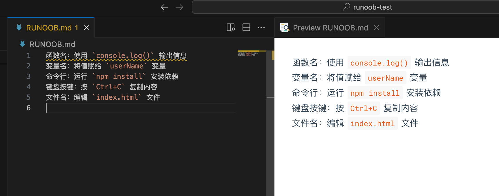

# text

## ~~first~~
***
<u>这段文字包含**粗体**、*斜体*和***粗斜体***的组合效果。</u> [^AAA]

[^AAA]:i am your father

使用 `git commit` 命令提交代码
<mark>变量 `userName` 存储用户名</mark>
在终端中输入 `npm install` 安装依赖

- sss  
5. sss  
7. www  
9. qqq

1. 主要任务
   - 子任务A
   - 子任务B
     1. 详细步骤1
     2. 详细步骤2
   - 子任务C
2. 次要任务

- [x] 未完成的任务
- [x] 已完成的任务
- [ ] 另一个未完成的任务

>http://
ee  
erewr
i
k

k

> **用户反馈**：这个功能很有用！
> 
> > **开发团队回复**：感谢您的反馈，我们会继续优化。
> > 
> > > **项目经理补充**：预计下个版本会有更多改进。

## Markdown 代码(展示)  
### 行内代码  
如果是段落上的一个函数或片段的代码可以用反引号把它包起来（`）  
>eg. ``  `printf()` 函数 ``  

显示结果如下:  
`printf()` 函数  
#### 常见用法示例： 
- 函数名：使用 console.log() 输出信息  
- 变量名：将值赋给 userName 变量  
- 命令行：运行 npm install 安装依赖  
- 键盘按键：按 Ctrl+C 复制内容  
- 文件名：编辑 index.html 文件  
  

#### 特殊字符转义
当需要在行内代码中显示反引号或其他特殊字符时，需要进行转义处理。

显示反引号的方法：

**使用双反引号包围单反引号**

